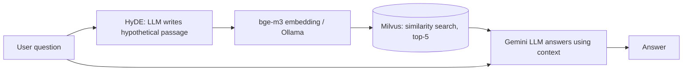

# 🔎 RAG with HyDE: a Q&A assistant over PDF documents

[🇧🇷 Português](README.md) · 🇺🇸 English

A Python assistant that answers questions (in Portuguese) **using only the content of PDF documents**. Here the documents are credit card benefit guides (*Gold*, *Platinum* and *Standard*). The pipeline uses **RAG (Retrieval-Augmented Generation)** with the **HyDE** technique to improve retrieval, plus an **automatic evaluation module** that measures answer and retrieval quality.


## 🎯 The problem

LLMs don't know your documents and may hallucinate. RAG fixes this by retrieving the relevant passages and handing them to the model as context. The system prompt forces the model to answer only from that context, or to say it found nothing.

Customer questions ("what do I do if my card is stolen?") and official document text ("in case of loss or theft, notify immediately...") use different vocabulary, so similarity search doesn't always match them. **HyDE** addresses this.

## ✨ Technical highlights

- **HyDE (Hypothetical Document Embeddings):** the LLM writes a hypothetical passage that would answer the question, and that passage, not the question, is used for vector search because it resembles the documents more.
- **Token-based chunking:** `RecursiveCharacterTextSplitter` using the embedding model's own tokenizer (`BAAI/bge-m3`), 1250-token chunks with 150 overlap.
- **Idempotent ingestion:** each chunk gets a SHA-256 ID (file, page, text). Duplicates are dropped and the collection is only re-indexed when needed (`REINDEX = True`).
- **Local embeddings:** `bge-m3` served by **Ollama**, at no cost and without sending documents to third parties.
- **Vector database:** **Milvus Lite**, a local file with no server.
- **LangGraph orchestration:** the flow is a state graph `hyde → retrieve → generate`.
- **Automatic evaluation (LLM-as-a-judge):** a synthetic Q&A dataset is generated from the chunks themselves and an LLM judge grades each answer.

## 🧠 How it works



### 1. Ingestion (run once)


PDFs → chunks → embeddings → stored in Milvus.


### 2. Query


1. **HyDE:** the question becomes a hypothetical paragraph.
2. **Retrieve:** the paragraph is embedded and the 5 nearest chunks are retrieved.
3. **Generate:** the question and chunks go to Gemini, which answers in at most 100 words using only the context.


> The image illustrates the HyDE idea. This project generates 1 hypothetical document instead of 3.

## 📊 Evaluation and results

The script measures the system end to end:

1. Samples chunks (fixed seed, 42) and asks the LLM for a question and a reference answer for each.
2. Runs the RAG with the question only.
3. An LLM judge compares the system answer with the reference (`CORRETO` / `INCORRETO`, i.e. correct / incorrect).
4. Checks whether the source chunk was retrieved (**hit@k**).

Results from the run included in the repo (`resultados_avaliacao.json`, 28 valid questions):

| Metric | Result |
|---|---|
| Answer accuracy (LLM judge) | **85.7%** (24/28) |
| Source chunk retrieved (hit@5) | **89.3%** (25/28) |
| Accuracy when the chunk was retrieved | **92.0%** (23/25) |

The gap between the last two rows shows most errors come from **retrieval**, which points to the next steps below.

> ⚠️ The dataset is small and synthetic, and the judge is an LLM. These numbers are an indicator, not a rigorous benchmark.

## 🛠️ Stack

| Layer | Technology |
|---|---|
| Language | Python |
| Orchestration | LangChain, LangGraph |
| LLM (generation, HyDE, judge) | Google Gemini (`gemini-3.1-flash-lite`) |
| Embeddings | `bge-m3` via Ollama |
| Vector DB | Milvus Lite |
| PDF parsing | PyPDF |
| Data validation | Pydantic |

## 🚀 Getting started

**Requirements:** Python 3.10+, [Ollama](https://ollama.com/) and a [Google Gemini API](https://aistudio.google.com/) key.

```bash
# 1. Clone
git clone https://github.com/tiagomafratm22-source/rag-hyde-pdf-qa
cd rag-hyde-pdf-qa

# 2. Virtual env and dependencies
python -m venv venv
venv\Scripts\activate        # Windows  (Linux/macOS: source venv/bin/activate)
pip install -r requirements.txt

# 3. Local embedding model
ollama pull bge-m3:567m

# 4. Environment variables: create a .env file
#    GOOGLE_API_KEY=your_key
#    LANGSMITH_API_KEY=optional

# 5. Put your PDFs in documentos/ and run
python main.py
```

On the first run the script indexes the PDFs, answers 3 sample questions, generates the evaluation dataset (`qa_dataset.json`) and saves results to `resultados_avaliacao.json`. Later runs reuse the database and dataset. Delete `qa_dataset.json` if you change the PDFs or chunking, and set `REINDEX = True` to re-index.

### Web UI (Streamlit)

After the first `main.py` run (which indexes the PDFs), launch the UI:

```bash
streamlit run app.py
```

The page shows every pipeline step: the HyDE hypothetical passage, the answer, and the retrieved chunks with file and page.

<!-- Add a screenshot here:  -->

### Main settings (in `main.py`)

| Parameter | Default | Purpose |
|---|---|---|
| `K` | 5 | Chunks retrieved per question |
| `chunk_size` / `chunk_overlap` | 1250 / 150 | Chunk size and overlap, in tokens |
| `REINDEX` | `False` | Rebuild the collection from scratch |
| `N_AVALIACAO` | 30 | Questions in the evaluation dataset |
| `MAX_CONCORRENCIA` | 4 | Parallel LLM requests |

## 💬 Example

```text
Question: Como fazer um seguro viagem? (How do I get travel insurance?)

Answer (translated from Portuguese): To be covered, the authorized public transport
ticket must be paid with the eligible Mastercard Platinum card (or with points from an
associated rewards program), including taxes and fees. The Insurance Ticket must be
issued through www.aig.com/Mastercard/pt, as it must be presented in case of a claim.
```

## 🗺️ Next steps

- [ ] Compare HyDE against direct search, *multi-query* and *query rewriting* on the same evaluation dataset
- [ ] Add *reranking* and hybrid search (BM25 + vector) to improve hit@k
- [ ] Cite source and page in every answer
- [ ] Web UI (Streamlit/Gradio) or API (FastAPI)
- [ ] Split `main.py` into modules (ingestion, graph, evaluation) and add tests

## 📁 Structure

```text
.
├── main.py                    # Ingestion, RAG graph and evaluation
├── app.py                     # Streamlit UI
├── LICENSE                    # MIT
├── documentos/                # Knowledge-base PDFs
├── qa_dataset.json            # Generated evaluation dataset
├── resultados_avaliacao.json  # Per-question detailed results
├── requirements.txt
└── assets/                    # README images
```

## 👤 Author

**Tiago Mafra** · [LinkedIn](https://www.linkedin.com/in/tiago-mafra-578b51a0/) · [GitHub](https://github.com/tiagomafratm22-source)

A portfolio project built to apply RAG and LLM concepts learned in courses. I'm looking for my first opportunity in IT, and I'd be glad to talk.
