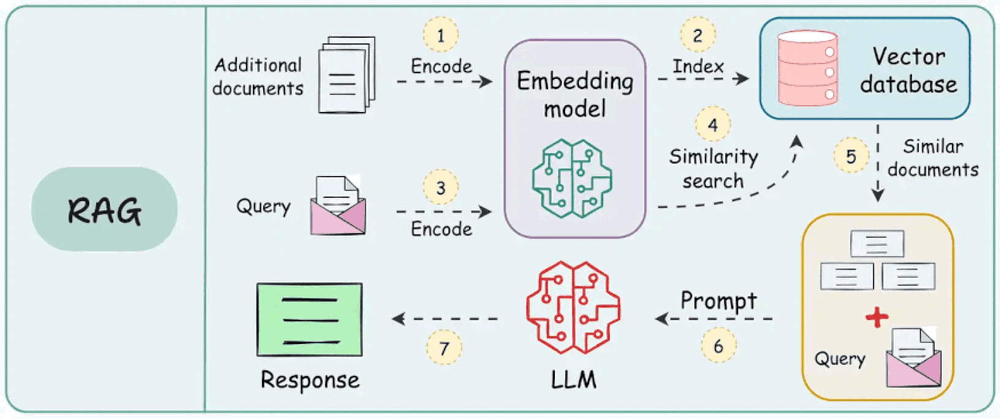
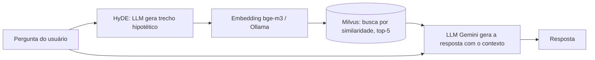
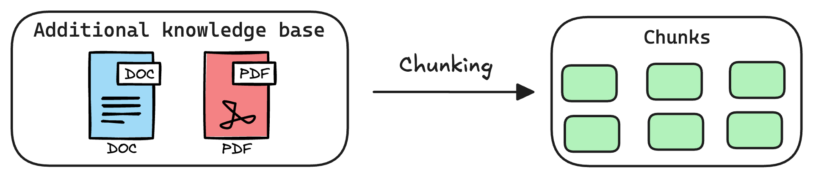
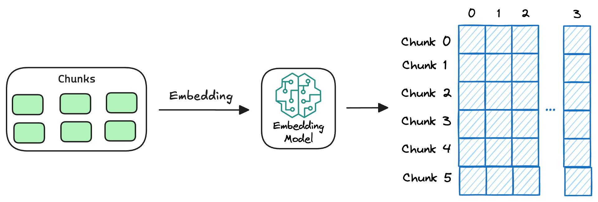
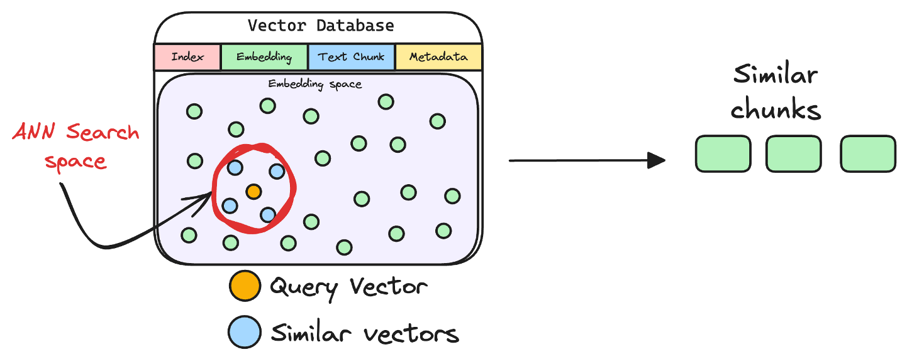

# 🔎 RAG com HyDE: assistente de perguntas e respostas sobre PDFs

🇧🇷 Português · [🇺🇸 English](README.en.md)

Assistente em Python que responde perguntas em português **usando apenas o conteúdo de documentos PDF**. Neste projeto, os documentos são os guias de benefícios de cartões de crédito *Gold*, *Platinum* e *Standard*. O pipeline usa **RAG (Retrieval-Augmented Generation)** com a técnica **HyDE** para melhorar a recuperação. Um **módulo de avaliação automática** mede a qualidade das respostas e da busca.



## 🎯 O problema

LLMs não conhecem os seus documentos e podem "inventar" respostas. O RAG resolve isso buscando os trechos relevantes e entregando-os ao modelo como contexto. O prompt do sistema o obriga a responder só com esse contexto ou a dizer que não encontrou a informação.

Perguntas de clientes ("o que faço se meu cartão for roubado?") e textos de documentos oficiais ("em caso de perda ou roubo, comunique imediatamente...") têm vocabulário diferente. A busca por similaridade nem sempre aproxima os dois. A **HyDE** ataca esse problema.

## ✨ Destaques técnicos

- **HyDE (Hypothetical Document Embeddings):** o LLM escreve um trecho hipotético que responderia à pergunta. A busca vetorial usa esse trecho no lugar da pergunta, porque ele se parece mais com o texto dos documentos.
- **Chunking por tokens:** `RecursiveCharacterTextSplitter` com o tokenizer do próprio modelo de embedding (`BAAI/bge-m3`), com chunks de 1250 tokens e 150 de overlap.
- **Ingestão idempotente:** cada chunk recebe um ID (SHA-256 de arquivo, página e texto). Duplicatas são descartadas, e a coleção só é reindexada quando necessário (`REINDEX = True`).
- **Embeddings locais:** `bge-m3` rodando via **Ollama**, sem custo e sem enviar os documentos para terceiros.
- **Banco vetorial:** **Milvus Lite**, em um arquivo local e sem servidor.
- **Orquestração com LangGraph:** o fluxo é um grafo de estados `hyde → retrieve → generate`.
- **Avaliação automática (LLM-as-a-judge):** o projeto gera um dataset sintético de perguntas e respostas a partir dos próprios chunks e usa um LLM juiz para classificar cada resposta.

## 🧠 Como funciona



### 1. Ingestão (executada uma vez)



PDFs → chunks → embeddings → armazenados no Milvus.



### 2. Consulta



1. **HyDE:** a pergunta vira um parágrafo hipotético.
2. **Retrieve:** esse parágrafo é transformado em embedding e os 5 chunks mais próximos são recuperados.
3. **Generate:** a pergunta e os chunks vão para o Gemini, que responde em até 100 palavras só com base no contexto.


> A imagem acima ilustra a ideia do HyDE. Neste projeto, em vez de 3 documentos hipotéticos, é gerado 1.

## 📊 Avaliação e resultados

O script mede o sistema de ponta a ponta:

1. Sorteia chunks (seed fixa, 42) e pede ao LLM uma pergunta e uma resposta de referência para cada um.
2. Roda o RAG só com a pergunta.
3. Um LLM juiz compara a resposta do sistema com a referência (`CORRETO` / `INCORRETO`).
4. Verifica se o chunk de origem da pergunta foi recuperado (**hit@k**).

Resultado na execução incluída no repositório (`resultados_avaliacao.json`, 28 perguntas válidas):

| Métrica | Resultado |
|---|---|
| Acerto da resposta (juiz LLM) | **85,7%** (24/28) |
| Recuperação do chunk de origem (hit@5) | **89,3%** (25/28) |
| Acerto quando o chunk foi recuperado | **92,0%** (23/25) |

A diferença entre as duas últimas linhas mostra que a maior parte dos erros vem da **etapa de recuperação**. Isso aponta para os próximos passos abaixo.

> ⚠️ O dataset é pequeno e sintético, e o juiz é um LLM. Os números são um indicador, não um benchmark rigoroso.

## 🛠️ Stack

| Camada | Tecnologia |
|---|---|
| Linguagem | Python |
| Orquestração | LangChain, LangGraph |
| LLM (geração, HyDE, juiz) | Google Gemini (`gemini-3.1-flash-lite`) |
| Embeddings | `bge-m3` via Ollama |
| Banco vetorial | Milvus Lite |
| Leitura de PDF | PyPDF |
| Validação de dados | Pydantic |

## 🚀 Como executar

**Pré-requisitos:** Python 3.10+, [Ollama](https://ollama.com/) e uma chave API do LLM de sua preferência.

```bash
# 1. Clone e entre na pasta
git clone https://github.com/tiagomafratm22-source/rag-hyde-pdf-qa
cd rag-hyde-pdf-qa

# 2. Ambiente virtual e dependências
python -m venv venv
venv\Scripts\activate        # Windows  (Linux/macOS: source venv/bin/activate)
pip install -r requirements.txt

# 3. Modelo de embedding local
ollama pull bge-m3:567m

# 4. Variáveis de ambiente: crie um arquivo .env
#    GOOGLE_API_KEY=sua_chave
#    LANGSMITH_API_KEY=opcional

# 5. Coloque seus PDFs na pasta documentos/ e execute
python main.py
```

Na primeira execução, o script indexa os PDFs, responde 3 perguntas de exemplo, gera o dataset de avaliação (`qa_dataset.json`) e salva os resultados em `resultados_avaliacao.json`. Nas execuções seguintes, ele reaproveita o banco e o dataset. Apague `qa_dataset.json` se trocar os PDFs ou o chunking, e use `REINDEX = True` para reindexar.

### Interface web (Streamlit)

Depois da primeira execução do `main.py` (que indexa os PDFs), abra a interface:

```bash
streamlit run app.py
```

A tela mostra cada etapa do pipeline: o trecho hipotético do HyDE, a resposta e os chunks recuperados, com arquivo e página.

<!-- Adicione aqui um print:  -->

### Configurações principais (em `main.py`)

| Parâmetro | Padrão | Função |
|---|---|---|
| `K` | 5 | Chunks recuperados por pergunta |
| `chunk_size` / `chunk_overlap` | 1250 / 150 | Tamanho do chunk e sobreposição, em tokens |
| `REINDEX` | `False` | Recria a coleção do zero |
| `N_AVALIACAO` | 30 | Perguntas do dataset de avaliação |
| `MAX_CONCORRENCIA` | 4 | Requisições paralelas ao LLM |

## 💬 Exemplo

```text
Pergunta: Como fazer um seguro viagem?

Resposta: Para ter cobertura, a passagem do transporte público autorizado deve ser paga
com o cartão Mastercard Platinum elegível (ou com pontos de um programa de recompensas
associado), incluindo impostos e taxas. É obrigatório emitir o Bilhete de Seguro pelo
portal www.aig.com/Mastercard/pt, pois ele deve ser apresentado em caso de sinistro.
```

## 🗺️ Próximos passos

- [ ] Comparar HyDE com busca direta, *multi-query* e *query rewriting* usando o mesmo dataset de avaliação
- [ ] Adicionar *reranking* e busca híbrida (BM25 + vetorial) para melhorar o hit@k
- [ ] Citar fonte e página em cada resposta
- [ ] Interface web (Streamlit/Gradio) ou API (FastAPI)
- [ ] Separar o `main.py` em módulos (ingestão, grafo, avaliação) e adicionar testes

## 📁 Estrutura

```text
.
├── main.py                    # Ingestão, grafo RAG e avaliação
├── app.py                     # Interface Streamlit
├── LICENSE                    # MIT
├── documentos/                # PDFs da base de conhecimento
├── qa_dataset.json            # Dataset de avaliação gerado
├── resultados_avaliacao.json  # Resultados detalhados por pergunta
├── requirements.txt
└── assets/                    # Imagens do README
```

## 👤 Autor

**Tiago Mafra** · [LinkedIn](https://www.linkedin.com/in/tiago-mafra-578b51a0/) · [GitHub](https://github.com/tiagomafratm22-source)

Projeto de portfólio, criado para aplicar na prática conceitos de RAG e LLMs aprendidos em cursos.
